# Alexandria · 亚历山大知识库

> 把资料编译成知识，而不是在提问时重新检索片段。
>
> 基于 **LLM Wiki / Dynamic Knowledge Repository** 理念、**本体论** 与 **团队权限** 的企业知识库。纯 Node 26 + SQLite；语义编译/检索/合成默认调用**本机 DSH**，不可用时自动回退规则与本地检索。

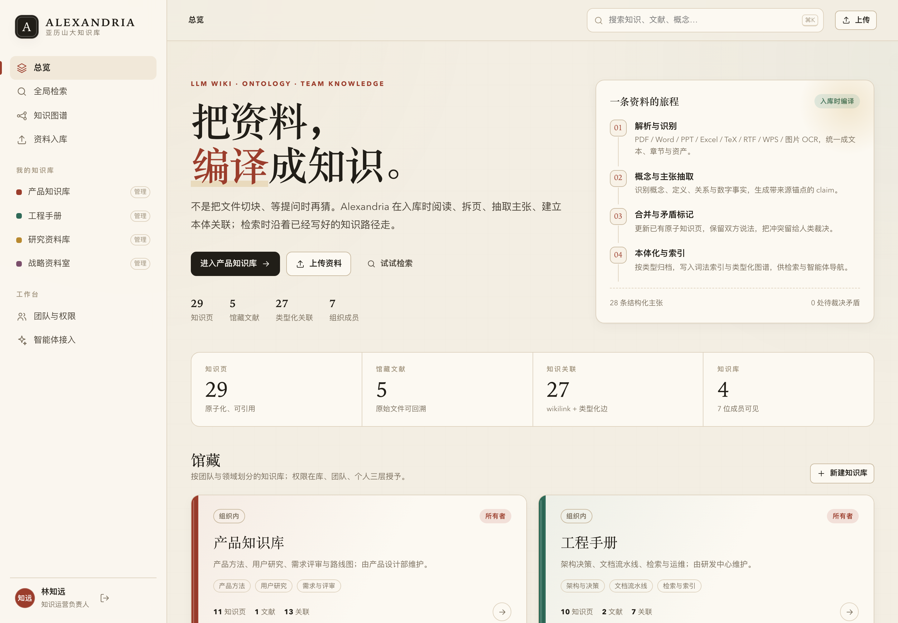

## 这是什么

Alexandria 借鉴了 Karpathy 的 [LLM Wiki](https://gist.github.com/karpathy/442a6bf555914893e9891c11519de94f) 模式与 [llm-wiki](https://github.com/geronimo-iia/llm-wiki) 引擎的设计：

- **知识在入库时编译**：阅读来源，拆成原子知识页，抽取结构化主张，建立类型化关联，标记矛盾。
- **查询时导航**：本机 DSH 在候选知识页上做语义重排与合成；底层是 SQLite FTS5 + 预编译知识图，不使用查询期向量切块。
- **本体驱动**：每个知识库有独立的本体（类型 / 属性 / 关系），页面不是文章，而是可校验、可遍历的知识对象。
- **像图书馆一样组织**：分库 → 目录（书架/分类）→ 知识页 / 文献；团队与个人授权，严格权限过滤。
- **面向智能体**：后台通过本机 DSH headless 执行语义编译/重排/合成；DSH 智能体也可通过 Agent API + SKILL.md 维护知识。
- **文档能力全面**：PDF、DOCX/DOC、PPTX、XLSX、TeX、RTF、WPS、图片 OCR、Markdown、HTML、CSV/JSON、ODT/EPUB 等。

## 快速开始

要求 Node.js ≥ 22.18（推荐 Node 26）。**不需要安装任何运行时依赖**，服务端只用 `node:sqlite`、`node:http`、`node:zlib` 等内置模块。

```bash
cd alexandria
node server/src/seed/run-seed.ts --force   # 可选：写入演示组织、知识库与文献
node server/src/main.ts                    # http://127.0.0.1:4520
```

打开 <http://127.0.0.1:4520>，使用演示账号：

| 邮箱 | 姓名 | 角色 | 密码 |
| --- | --- | --- | --- |
| `lin@alex.dev` | 林知远 | 组织管理员 | `alex-demo` |
| `shen@alex.dev` | 沈书言 | 知识策展人 / 战略库所有者 | `alex-demo` |
| `su@alex.dev` | 苏禾 | 产品负责人 | `alex-demo` |
| `zhou@alex.dev` | 周砚 | 研发负责人 | `alex-demo` |
| `guest@alex.dev` | 访客 | 只读成员（看不到战略库） | `alex-demo` |

开发与验证：

```bash
pnpm test          # 或 npm test；Node 内置测试运行器
pnpm typecheck     # 需要 TypeScript（当前工作区可从 aiwo/node_modules 链接）
```

> 本仓库开发时通过 `node_modules -> ../aiwo/node_modules` 复用 TypeScript 编译器；运行时不需要它。

## 一眼看懂

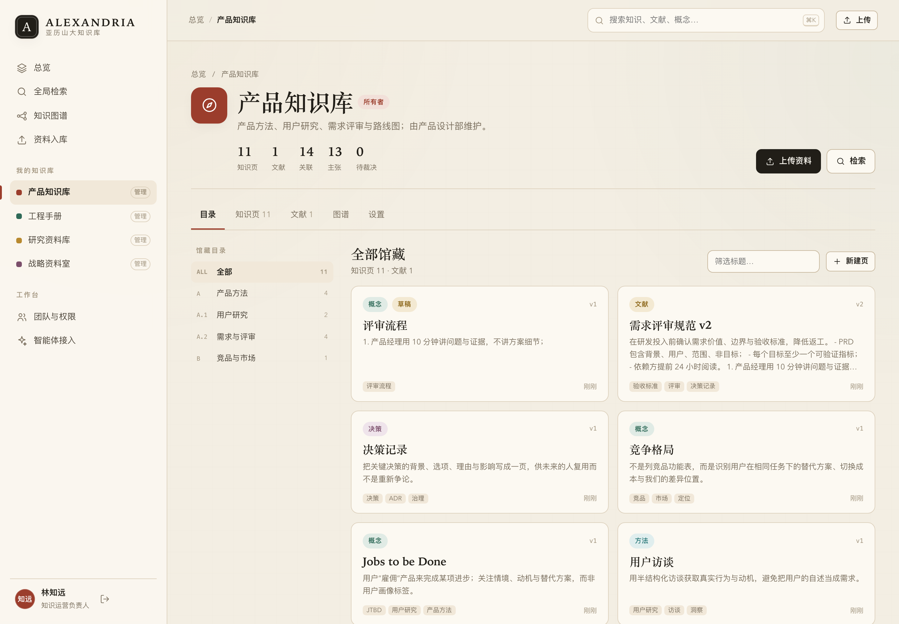

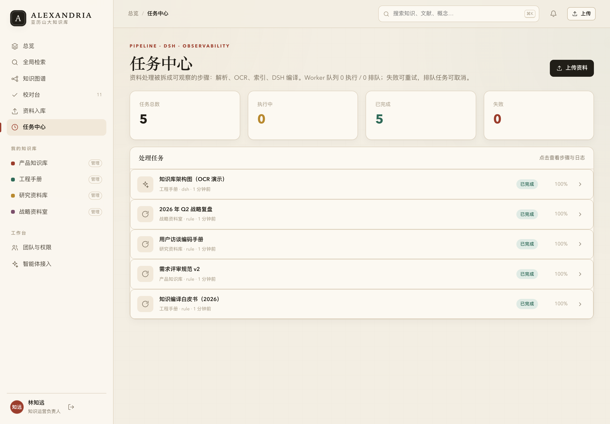

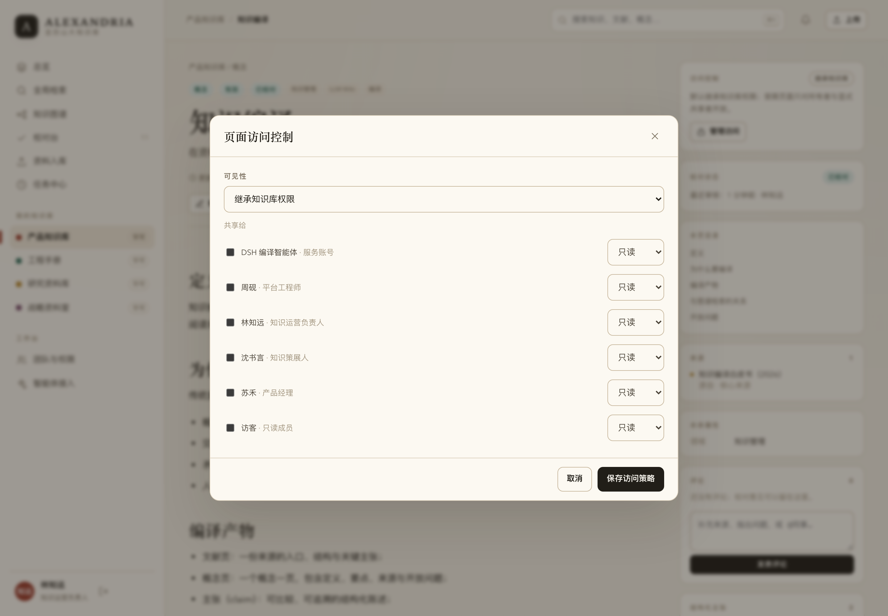

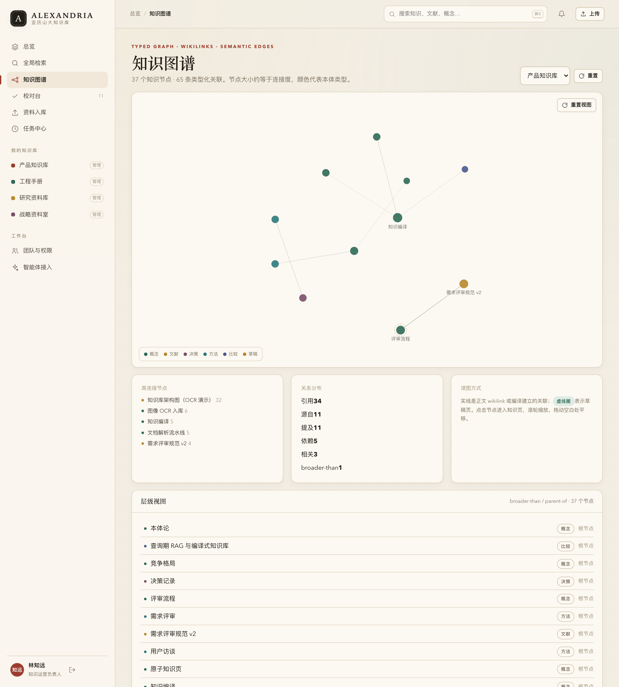

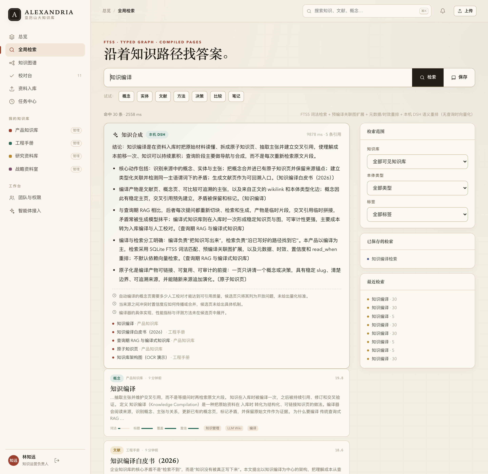

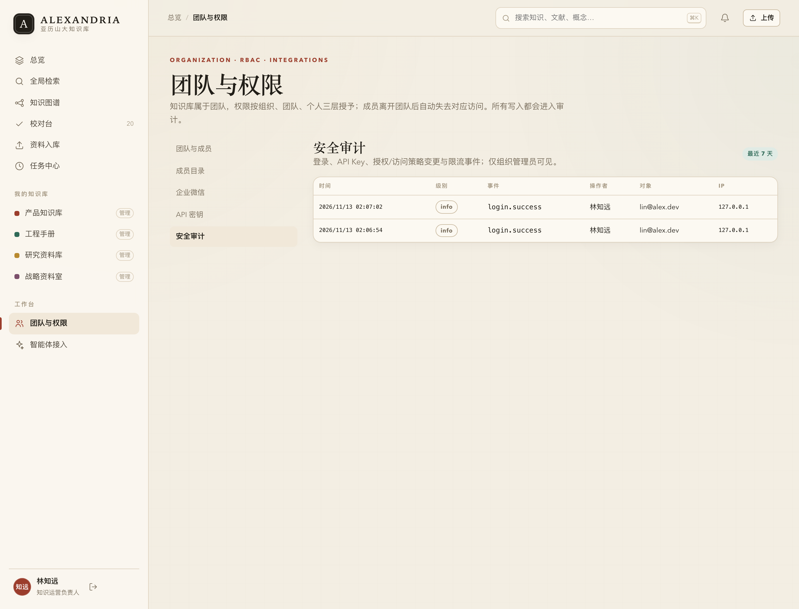

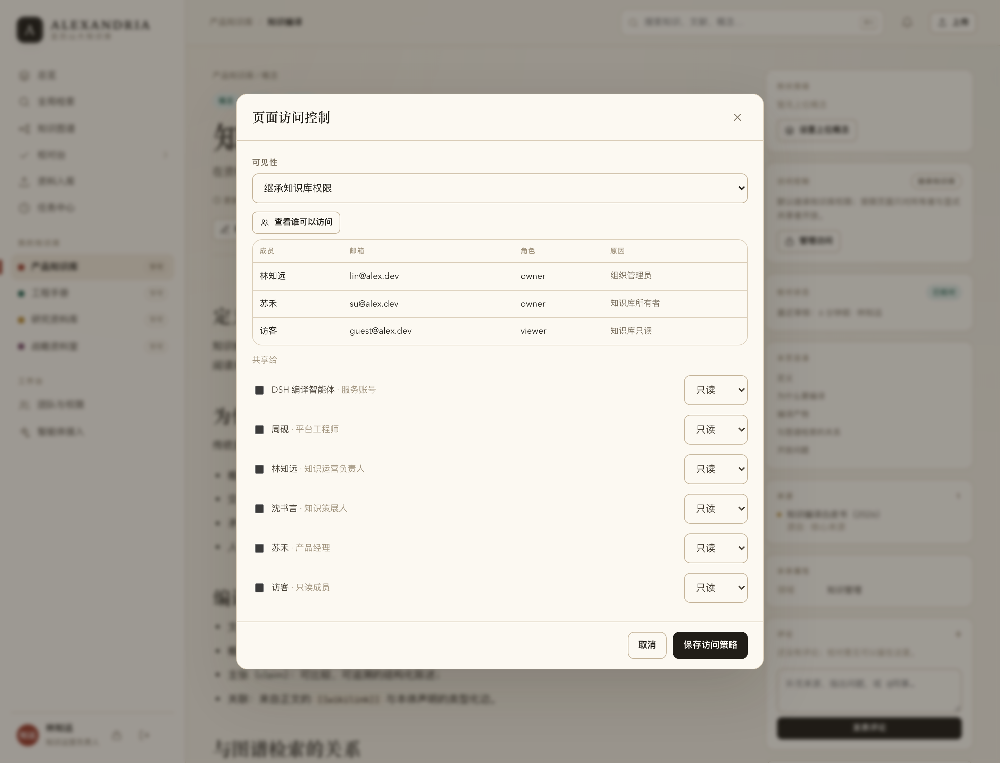

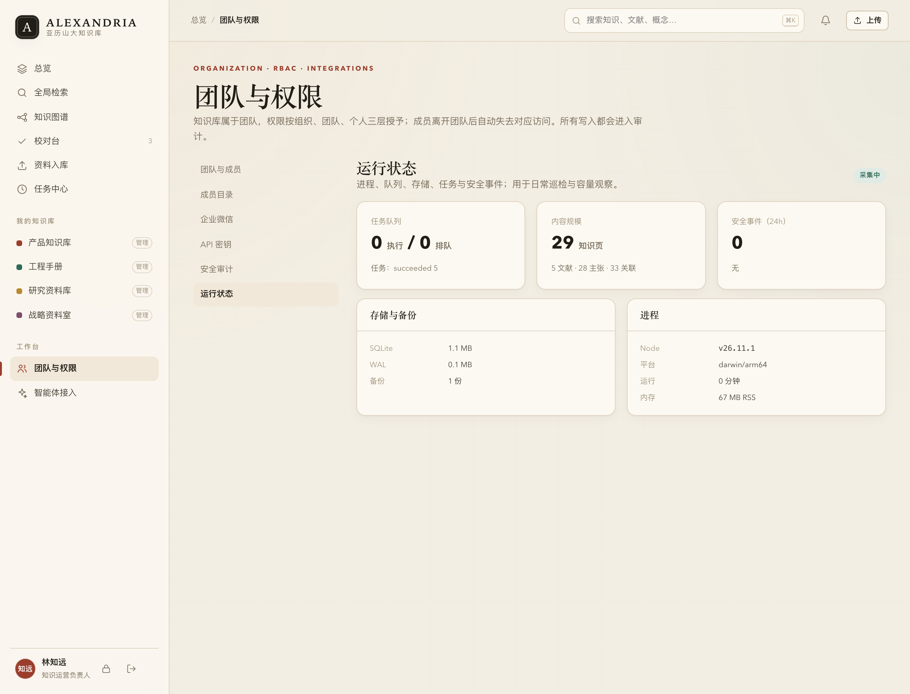

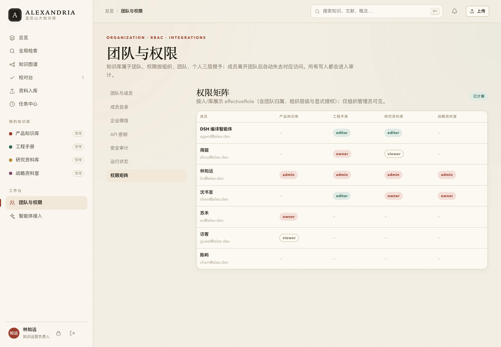

| 能力 | 实现 |
| --- | --- |
| **分库** | 每个知识库独立的本体、目录树、权限、检索范围 |
| **分类组织** | 库内目录树（书架 / 分类 / 主题），类似 BookStack 的 Shelf → Book → Chapter → Page |
| **知识编译** | 本机 DSH 抽取概念、实体、事实、主张与上下位关联；生成文献页/概念页/实体页 |
| **本体论** | 类型 + 属性 + 关系；内置类型带属性定义，可扩展类型/属性；页面按类型渲染属性表单 |
| **检索** | FTS5（中文单字/双字切分）+ BM25 + 图谱一跳扩展 + 元数据/时效/read_when 重排 |
| **知识合成** | 本机 DSH 基于候选知识页做语义重排与带引用合成；失败回退编译式答案 |
| **本机 DSH** | 入库编译、语义检索重排、知识合成；无凭据时回退规则编译器与 FTS/图谱 |
| **权限** | 组织层级（上级只读下级，下级不可反查上级）+ 库/页面/文献 ACL + 定向共享；每次查询先过滤 |
| **文档** | 12+ 格式；PDF 文本层、Office XML、图片 OCR、RTF/WPS 兜底 |
| **智能体** | `/api/agent/*` API Key、manifest、SKILL.md、lint、编译与写入 |
| **可追溯** | 页面版本、审计事件、来源锚点、主张级置信度、矛盾标记；删除页回收站 |
| **维护** | 过期会话/挑战清理、回收站/审计保留期、备份完整性校验、可选自动备份 |
| **可移植** | 知识页/整库导出 LLM Wiki 风格 Markdown（frontmatter + 主张 + 来源 + 链接） |
| **校对台** | 草稿/退回/矛盾队列；批准、要求修改、撤回校对、逐条裁决主张 |
| **任务中心** | worker 队列执行解析/OCR/索引/DSH 编译；分步事件、耗时、失败重试、排队取消 |
| **运行状态** | 队列、内容规模、安全事件、SQLite/WAL、备份与进程资源；数据体检/恢复脚本 |
| **实体治理** | 重复建议、合并审批流、归档指针、别名回填；手动设置上位概念 |
| **安全审计** | 登录/限流/API Key/授权/ACL 事件；权限变更站内+企微通知 |
| **访问审计** | 页面有效访问名单、角色与原因；管理员权限矩阵按人/库展示有效角色 |
| **层级图谱** | broader-than / parent-of 树；类型过滤、最短路径、页面侧栏 |
| **检索分面** | 库、本体类型、标签分面；权限感知；DSH 语义重排 |
| **检索服务** | 查询历史、保存检索、自动补全、分页加载；结果先出，DSH 合成异步补入 |
| **协作与通知** | 页面评论、解决标记、站内通知、企业微信应用消息推送 |
| **企业 SSO** | OIDC 授权码登录，映射本地账号；登录页按配置出现 SSO 入口 |
| **2FA / 密码策略** | TOTP 动态码、10 个恢复码、会话撤销、密码复杂度、异常登录告警 |
| **SCIM 2.0** | /scim/v2/Users、/Groups；创建/停用/组成员供给 |
| **企业微信** | 已接 Mock OAuth 登录与通讯录同步；生产可切换 QYAPI/授权域名 |

### 知识编译 vs 查询期 RAG

| 维度 | 查询期 RAG | Alexandria |
| --- | --- | --- |
| 知识形成 | 每次提问时重新切块 | 入库时编译一次 |
| 产物 | 临时片段 | 知识页 + 主张 + 类型化图 |
| 交叉引用 | 查询时临时拼接 | 预先维护并可导航 |
| 矛盾 | 常被生成模型抹平 | 保留双方并标记待裁决 |
| 检索默认 | 向量相似度 | BM25 + 图谱扩展 + 重排 |
| 可审计 | 弱 | 页面版本、来源、审计、信号分解 |

## 使用路径

1. **建库**：首页「新建知识库」，绑定团队与可见性；系统自动写入默认本体与两个目录。
2. **上传资料**：支持拖拽；解析与编译异步执行，在「任务中心」查看每个步骤、耗时、DSH 日志与失败重试。
3. **阅读与校正**：打开概念页，查看来源、主张、出链/入链与邻域图谱；人工编辑正文、类型、置信度与标签。
4. **校对与裁决**：进入「校对台」处理自动编译的草稿；批准、退回或撤回校对。页面内可直接对冲突主张选择「采用」或「驳回」。
5. **检索与合成**：全局检索给出词法 + 图谱的命中与信号分解；「知识合成」返回带引用的答案，并标注草稿与缺口。
6. **本机 DSH**：默认读取 `~/.dsh` 凭据；没有 DSH 或凭据时自动回退，不影响基本使用。
7. **接入外部智能体**：在「团队与权限 / API 密钥」创建读写密钥，把 [SKILL.md](skills/alexandria/SKILL.md) 交给 DSH。

## 架构

```text
┌────────────────────────────────────────────────────────────┐
│ Web（原生 ES Modules，无构建步骤）                          │
│ 总览 / 图书馆 / 阅读器 / 检索 / 上传 / 图谱 / 权限 / 智能体 │
└──────────────────────────┬─────────────────────────────────┘
                           │ HTTP + Cookie / API Key
┌──────────────────────────▼─────────────────────────────────┐
│ Alexandria Server（Node 26，TypeScript 直接运行）           │
│  auth · rbac · libraries · pages · ontology · search        │
│  ingest pipeline · DSH runtime · compiler/graph · agent API │
└───────────────┬──────────────────────────────┬──────────────┘
                │                              │
      ┌─────────▼─────────┐          ┌─────────▼─────────┐
      │ SQLite（WAL）      │          │ 文件系统           │
      │ 页面/本体/权限/审计 │          │ 原始文件/图片/缩略图│
      │ FTS5 派生索引      │          │ 可重建、可备份     │
      └───────────────────┘          └───────────────────┘
```

### 目录

```text
alexandria/
├── server/src/
│   ├── db/                 schema.sql、SQLite 封装与迁移
│   ├── http/               router、context、auth、static
│   ├── domain/             RBAC、审计
│   ├── extract/            PDF/DOCX/PPTX/XLSX/TeX/RTF/WPS/图片等
│   ├── ingest/             上传、解析、OCR、编译任务
│   ├── knowledge/          分词、FTS、编译器、主张、图谱、查询
│   ├── routes/             REST 与 Agent API
│   └── seed/               演示组织、知识库、文献与页面
├── web/                    原生 SPA（HTML/CSS/ESM）
├── skills/alexandria/      DSH 技能工作流
├── tests/                  Node 内置测试
└── docs/                   设计、研究、API 文档
```

## 支持的文件格式

| 格式 | 处理方式 | 说明 |
| --- | --- | --- |
| PDF | `pypdf` → 文本层；扫描件抽取内嵌页面图片做 OCR；兜底流式 `Tj/TJ` 抽取 | 纯矢量无文本层仍会明确提示 |
| DOCX | ZIP + `word/document.xml` | 标题、段落、表格、内嵌图片 |
| DOC | LibreOffice（若安装）→ `textutil` → OLE 兜底 | 质量随环境降级并记录 |
| PPTX | ZIP + 幻灯片 XML | 逐页文本、图片资产 |
| XLSX | ZIP + 共享字符串/工作表 | 多表转 Markdown 表格 |
| TeX | 章节/摘要/命令清理 | 保留结构 |
| RTF | `textutil` → 内置 RTF 解析 | 中文 `\uN` 转义 |
| WPS | OOXML 变体按 DOCX；OLE 走兜底 | 新 WPS 多为 OOXML |
| 图片 | Tesseract `chi_sim+eng` + `sips` 缩略图 | OCR 文本并入知识 |
| Markdown / HTML | 标题与正文 | 支持 wikilink |
| CSV / TSV / JSON | 表格化 | 大表截断并标注 |
| ODT / EPUB | ZIP + XML / XHTML | 开放文档 |

## 权限模型

### 组织层级

- 团队是树：`总部 → 研发中心 → 知识运营组`。
- **上级负责人**可读取下级团队拥有的知识库（默认 `viewer`），不能自动获得编辑权。
- **下级成员**不会看到上级团队的知识库，除非被显式授权或页面/文献定向共享。
- 组织管理员拥有全部权限；`internal` 不再等于“所有登录用户可见”。

### 资源级 ACL

- 知识页与文献支持 `inherit`（继承知识库）、`restricted`（仅所有者与共享对象）、`private`（仅资源所有者与共享对象）。
- 共享对象可以是个人或团队，权限为 `viewer` / `editor`。
- 无权限访问返回 `404`，避免泄漏资源存在。

### 库级授权

- **组织管理员**：所有知识库 owner，管理账号、团队、集成。
- **团队归属**：知识库绑定团队后，团队负责人自动 owner，成员 editor。
- **库级授权**：对个人 / 团队 / 组织授予 viewer / editor / owner。
- **可见性**：`private`（仅显式授权）、`internal`（团队/层级/显式授权命中，不再对所有登录用户开放）、`public`（登录成员只读）。
- **严格隐藏**：无权限访问私有库/受限页/受限文献返回 `404`，不泄漏是否存在。
- **资源级 ACL**：页面与文献可在阅读器/文献详情中设置 `inherit/restricted/private`，并按个人/团队定向共享；每次列表、检索、图谱、导出、评论、Agent 读写都会复核。
- **API Key 范围**：`read` 只能调用检索/读取类接口；`write` 才能编译与写入。

## Agent API

```bash
# 创建密钥（Web：团队与权限 → API 密钥）
curl -s http://127.0.0.1:4520/api/agent/search \
  -H "Authorization: Bearer $ALEX_API_KEY" \
  -H "content-type: application/json" \
  -d '{"query":"知识编译","limit":5}'
```

核心端点：

| 方法 | 路径 | 作用 |
| --- | --- | --- |
| GET | `/api/agent/manifest` | 工具清单与设计原则 |
| POST | `/api/agent/search` | 检索知识页 / 文献，返回信号分解 |
| POST | `/api/agent/ask` | 带引用的知识合成 |
| POST | `/api/agent/read` | 页面 + 主张 + 来源 + 关联 + context |
| POST | `/api/agent/ingest` | 文本 / base64 资料入库并编译 |
| POST | `/api/agent/page` | 创建或更新知识页（保留列表字段） |
| POST | `/api/agent/compile` | 重新编译文献 |
| POST | `/api/agent/lint` | 孤儿页 / 断链 / 失败文献 / 草稿 |
| GET | `/api/agent/skill` | SKILL.md 原文 |
| GET | `/api/pages/:id/markdown` | LLM Wiki 风格页面 Markdown |
| GET | `/api/libraries/:id/export.md` | 整库 Markdown bundle |

完整接口见 [docs/API.md](docs/API.md)，工作流见 [skills/alexandria/SKILL.md](skills/alexandria/SKILL.md)。

## 企业微信

已实现 Mock OAuth 登录与通讯录同步：

```bash
# 1. 启动本地企业微信 Mock
cd ../wecom-mock && npm start        # http://127.0.0.1:4800

# 2. 启动 Alexandria
cd ../alexandria && node server/src/main.ts
```

登录页点击「企业微信登录（Mock）」，在 Mock 授权页选择员工，回调后会按 `wecom_userid` 映射到本地账号并建立会话。

- 团队 `wecom_dept_id`、成员 `wecom_userid` 字段；
- 管理员可在「团队与权限 → 企业微信」保存 CorpID / AgentID / Secret / API 地址 / 回调地址；
- `POST /api/integrations/wecom/sync` 拉取部门与成员并生成差异计划；`{ apply: true }` 执行绑定/建团队，`deactivateMissing: true` 停用通讯录中不存在的已绑定成员（管理员跳过）；
- 同步记录写入 `wecom_sync_runs`，管理端展示最近 5 次；部门 leader 映射到本地团队负责人（若企微返回）；
- 生产环境切换 `ALEXANDRIA_WECOM_MODE=wecom`，把 Base URL 指向 `https://qyapi.weixin.qq.com`、授权地址指向 `https://open.weixin.qq.com`，并把 `ALEXANDRIA_PUBLIC_URL` 配成企业微信可访问的地址。

企业微信应用消息通知已接入；JSON 机器人回调也已接入，可在 Mock 聊天中直接提问知识库。

## 设计文档

- [设计方案](docs/DESIGN.md)：架构、数据模型、编译、实体/事实、组织层级、资源 ACL、任务、企业微信。
- [参考研究](docs/RESEARCH.md)：Karpathy LLM Wiki、llm-wiki 引擎、BookStack、Outline 等源码与文档研究。
- [API 参考](docs/API.md)。
- [验收报告](docs/ACCEPTANCE.md)：需求映射、91 项测试证据与已知边界。
- [生产部署手册](docs/PRODUCTION.md)：进程、环境、备份、权限上线检查与容量边界。
- [单节点部署参考](docs/DEPLOY.md)：systemd、Nginx、上线检查。
- **安全审计与导出**：登录/限流/API Key/授权/ACL 事件；安全与审计 CSV 导出。
- [AGENTS.md](AGENTS.md)：仓库协作约定。

## 本体属性

每个知识库的每个类型可以声明属性（字符串 / 长文本 / 数字 / 日期 / 链接 / 布尔 / 枚举）。页面编辑器按类型动态渲染属性字段，属性值随页面版本保存。

- 管理端：知识库「设置 → 本体属性」新增/删除属性；
- 页面端：编辑页显示该类型的属性字段；读者侧显示 `本体属性` 卡片；
- API：`GET /api/libraries/:id/properties`、`POST /api/libraries/:id/properties`、`PATCH/DELETE /api/properties/:id`。

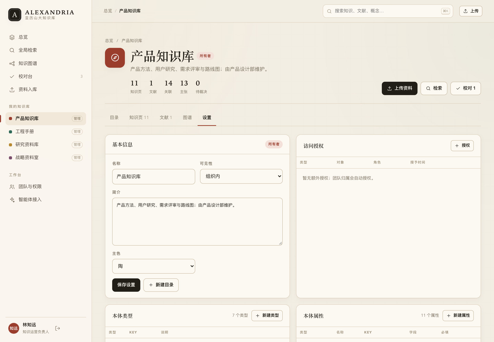

## 评论与通知

- 知识页右侧「评论」卡片支持发表、解决；负责人、创建者与父评论作者会收到站内通知；
- 顶部铃铛显示未读数量，`#/notifications` 集中处理；
- 通知同时通过企业微信应用消息推送（需绑定 wecom_userid），失败不影响主流程；
- 校对退回/通过也会产生通知。

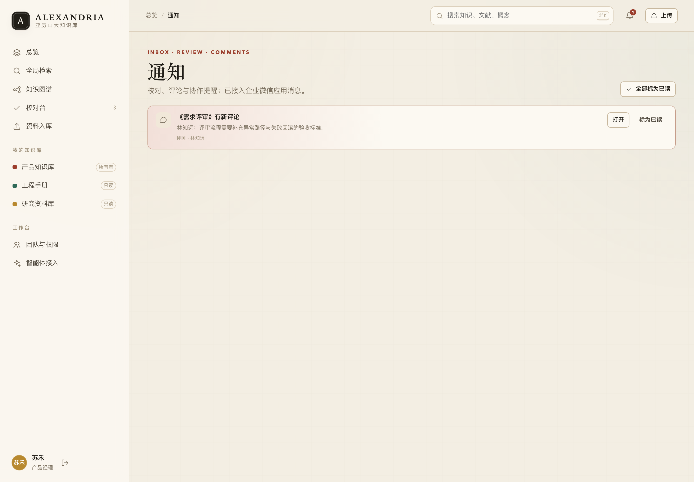

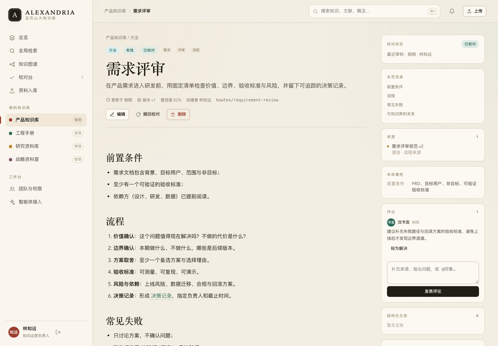

### 企业微信机器人问答（Mock JSON 回调）

1. 在 wecom-mock Dashboard 把回调模式设为 JSON，回调地址填 `http://127.0.0.1:4520/api/integrations/wecom/im`。
2. 在 Mock 聊天页与「应用机器人」单聊，发送：
   - `知识编译是什么？`（默认 `/ask`）
   - `/search 本体论`
   - `/help`
3. Alexandria 会按 `senderWecomId` 映射本地成员，按该成员权限检索已编译知识，返回带引用的回答。

> 生产环境使用企业微信加密 XML 回调：`GET/POST /api/wecom/callback`（签名校验、AES-256-CBC 解密、被动回复加密）。JSON 回调保留给本地 Mock 与内网联调。

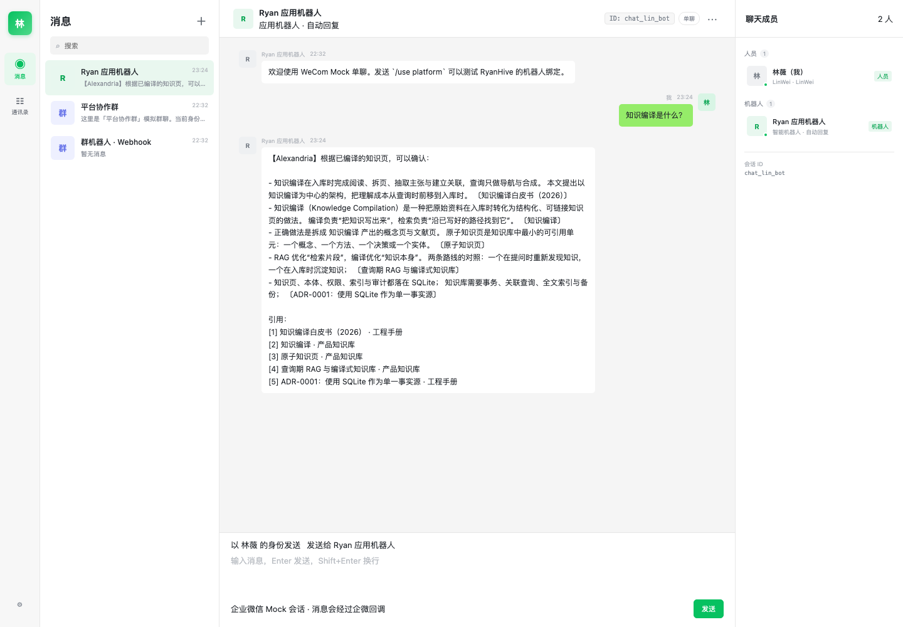

## 校对流程

```text
自动编译（draft / unreviewed）
   → 校对台
       ├── 批准 → active / approved（记录审核人与说明）
       ├── 要求修改 → draft / changes_requested（必填说明）
       ├── 撤回校对 → draft / unreviewed
       └── 矛盾主张 → 采用 / 驳回（保留双方，另一侧标记 resolved）
```

## 已知边界

- 扫描版 PDF 通过页面内嵌图片做 OCR；没有可抽取页面图片的纯矢量 PDF 仍需要外部渲染器。
- 旧版二进制 WPS / DOC 依赖 LibreOffice 或兜底抽取，质量有限，任务日志会明确标注。
- 自动编译出的概念页是**草稿**，需要人工校对后才能作为高置信来源；系统会标记 `draft` 与矛盾。
- 跨知识库 wikilink 暂不解析（按库隔离，避免权限泄漏）；智能体可通过受控 API 跨库检索。
- 暂未实现实时协同编辑、附件在线预览、评论 @ 提醒与通知订阅。
- 向量检索不是默认依赖；是否引入应由查询日志证明召回不足后再决策。

## 路线图

1. 扫描 PDF 页面渲染 OCR、图片版面分析、表格结构恢复。
2. 附件在线预览、评论 @ 提醒、知识页责任人轮值。
3. 通讯录增量同步、离职停用与部门负责人映射。
4. 跨库受控引用与知识联邦检索。
5. 编译质量评测集：引用准确率、矛盾关闭率、孤儿页比例。
6. 本机 DSH 编译质量评测与失败回退观测。

---

**设计参考与致谢**：Andrej Karpathy 的 LLM Wiki 概念；[geronimo-iia/llm-wiki](https://github.com/geronimo-iia/llm-wiki) 的 typed frontmatter / schema / MCP 工具设计；[BookStack](https://www.bookstackapp.com/) 的层级内容组织；[Outline](https://github.com/outline/outline) 的 Collection 权限模型；Vannevar Bush 的 Memex。
